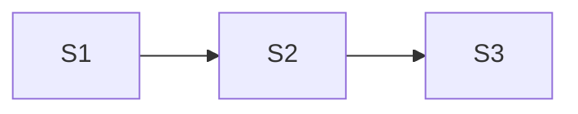

# Example stories.md

This is an example of the structure only. It follows the example PRD and architecture `back-in-stock-alerts`. The
facts are invented, and the GitHub numbers are blank because the issues aren't created yet. Copy the structure, not
the content.

````markdown
---
type: stories
slug: back-in-stock-alerts
status: draft
version: 1
date: 2026-11-22
author: jdoe
sources:
  [.agents/epics/back-in-stock-alerts/prd.md, .agents/epics/back-in-stock-alerts/architecture.md]
mode: brownfield
areas: [api, web, types]
---

# Stories — Back-in-stock email alerts

## Epic issue

- **Title**: Epic: Back-in-stock email alerts
- **Body**: Store customers can ask to be emailed when an out-of-stock product returns; store owners see pending
  alerts per product. PRD: `.agents/epics/back-in-stock-alerts/prd.md` · Architecture: `architecture.md` ·
  Stories: `stories.md`.
- **Labels**: enhancement · **GitHub**:

## Conventions every story inherits

Story workflow from `/story-spec GH-<n>` to `/story-retro`. Branches `GH-<n>-<slug>`. New services get unit tests
on `test/factories/`; user-facing flows get a Playwright spec with `data-testid`. The last acceptance bullet is
"`/story-validate GH-<n>` passes". Rules: `CLAUDE.md` and `.claude/rules/**`.

## Stories

### S1 — [SPIKE] API / Map every write to product stock

**Issue**

- **Title**: [SPIKE] API / Map every write to product stock
- **Labels**: enhancement, spike
- **Body**:

  ### User story

  As a platform developer, when I add stock alerts, I want to know every place that writes product stock so that
  alerts fire on every restock.

  ### Context

  The architecture triggers alerts from the products service when stock goes from 0 to more than 0. Rule: keep that
  if every write goes through the products service; otherwise switch to a scheduled scan.
  PRD: `.agents/epics/back-in-stock-alerts/prd.md` · Architecture: `architecture.md`.

  ### Acceptance criteria
  - Every write to `Product.stock` is listed with `file:line`.
  - The decision (service hook or scheduled scan) is recorded.

  ### SPIKE deliverable

  A short note in the story folder with each write path and the decision.

  ### Deployment notes

  none

  Blocked by: none

**Planning only** — GitHub: · Covers: AC3 · Areas: api (read only) · Data: Product · Wave 1 · Blocked by: none

### S2 — API / Store sign-ups and email customers when stock returns

**Issue**

- **Title**: API / Store sign-ups and email customers when stock returns
- **Labels**: enhancement
- **Body**:

  ### User story

  As a store customer, when the product I want is out of stock, I want to be emailed when it is back so that I can
  buy it without checking again.

  ### Context

  A new `stock-alerts` module; the products service calls it on restock (spike S1 decides the hook). Emails reuse
  the email queue and `MailService`. Out of scope: SMS, price alerts (PRD non-goals).

  ### Acceptance criteria
  - `POST /stock-alerts` stores one alert per email and product; a duplicate returns the existing alert.
  - A restock from 0 to more than 0 enqueues one email per pending alert and marks the alerts sent.
  - The email has `es` and `en` versions. The email address is never logged.
  - Unit tests for the stock-alerts service on `test/factories/` (new `stock-alert.factory.ts`).
  - `/story-validate GH-<n>` passes.

  ### Dev Notes

  New module via `new-api-module`, mirroring `products/`. The contract goes in `packages/types/src/stock-alert.types.ts`.
  The email job type goes in `src/queues/emails/email-job.types.ts`. Log `stock-alerts.alert.created` and
  `stock-alerts.email.queued` with `requestId`.

  ### Deployment notes

  Migration `add_stock_alerts` (via `schema-migration`). No new env keys.

  Blocked by: S1

**Planning only** — GitHub: · Covers: AC1, AC2 · Areas: api, types · Data: StockAlert, Product · Wave 2 ·
Blocked by: S1

### S3 — Storefront / Out-of-stock sign-up form and admin alert counts

**Issue**

- **Title**: Storefront / Out-of-stock sign-up form and admin alert counts
- **Labels**: enhancement
- **Body**:

  ### User story

  As a store customer, when a product is out of stock, I want to leave my email on its page so that I hear when it
  is back.

  ### Context

  Uses the S2 endpoint. The form is a Server Action validated with Zod. The admin sees pending alerts per product.

  ### Acceptance criteria
  - Out-of-stock product pages show the form; in-stock pages don't.
  - A sign-up shows a confirmation in `es` and `en`.
  - Admin › Stock alerts lists products with their pending alert count (admin role only).
  - A Playwright spec covers the sign-up with `data-testid` selectors.
  - `/story-validate GH-<n>` passes.

  ### Dev Notes

  Product page under `src/app/[locale]/products/[slug]/`. Server Action in `src/app/actions/`. Admin page under
  `src/app/[locale]/admin/stock-alerts/`, reads via `lib/admin/api.ts`.

  ### Deployment notes

  none

  Blocked by: S2

**Planning only** — GitHub: · Covers: AC1, AC4 · Areas: web · Data: StockAlert · Wave 3 · Blocked by: S2

## Parked

- Double opt-in for guest emails (PRD open question, waits for the store owner's answer).

## Dependency graph



## Execution order

Wave 1: S1 · Wave 2: S2 (after S1 is merged) · Wave 3: S3 (after S2 is merged)

## AC coverage

| Epic AC                                   | Stories |
| ----------------------------------------- | ------- |
| AC1 customers can sign up for an alert    | S2, S3  |
| AC2 one email when stock returns          | S2      |
| AC3 every restock path triggers alerts    | S1      |
| AC4 admin sees pending alerts per product | S3      |

## Open questions

- [ ] Double opt-in for guest emails (PRD open question).
````
